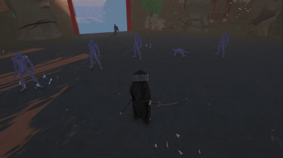
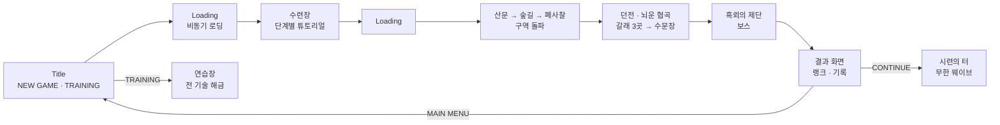
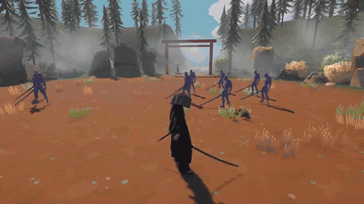
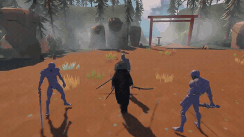
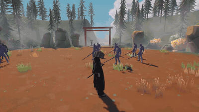
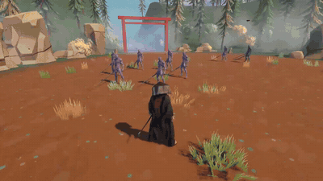
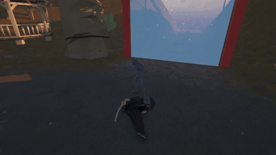
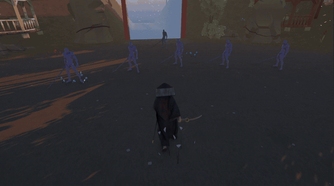
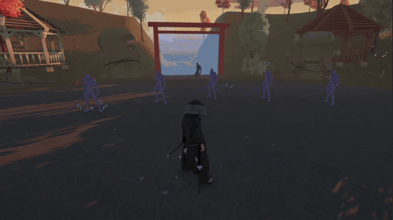
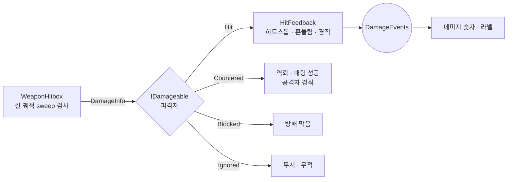

<div align="center">

# SEOMROE: Flash of Thunder

### 섬뢰 (閃雷)

**번개처럼 베고 납도하는 순간 낙뢰가 떨어지는, 콤보·발도·궁극기 중심의 Unity 3D 근접 액션**




</div>

<br/>

## 📌 프로젝트 개요

| 항목 | 내용 |
|---|---|
| **장르** | 3D 근접 액션 (구역 돌파형) |
| **엔진** | Unity 6000.2.8f1 (C#, URP) |
| **개발 기간** | 2026.10.23 ~ 2026.11.30 (약 한 달 반, 진행 중) |
| **개발 인원** | 1인 개발 (기획 · 프로그래밍 전담) |
| **플랫폼** | PC (Windows) |
| **기획서** | 슬라이드 기반 기획서 별도 제작 (v11) |

약·강 공격을 섞는 **분기 콤보**를 기본으로, 게이지 자원 **뇌기**를 써서 적 사이를 번개처럼 가르는 **섬뢰일도(Q)**, 적의 공격을 받아치는 **저스트 회피 · 패링 · 역뢰**, 모아 둔 게이지로 쓰는 **궁극기 3종(V)** 을 엮은 근접 전투를 목표로 했습니다. 타격 순간의 손맛(히트스톱 · 카메라 · 이펙트)은 *검은신화: 오공*을 레퍼런스로 삼았습니다.

타이틀 → 수련장(튜토리얼) → 본편 구역 → 던전 → 보스 → 결과 화면까지 하나의 흐름으로 동작합니다.

<br/>

## 🎮 조작법

| 입력 | 동작 |
|---|---|
| `W` `A` `S` `D` | 이동 |
| `마우스` | 카메라 |
| `마우스 좌클릭` | 약공격 (□) |
| `마우스 우클릭` | 강공격 (△) · 콤보 중 적 공격 직전이면 **역뢰**(받아치기) · 대기 중이면 **패링** |
| `마우스 우클릭` 홀드 | 차지 강타 |
| `Shift` | 회피 (적 공격 직전이면 **저스트 회피**) |
| `Space` | 점프 |
| `Q` 탭 | 섬뢰일도 — 가까운 적 한 명에게 돌진해 베기 (뇌기 1칸) |
| `Q` 홀드 | 발도 자세 — 흑백 속에서 조준해 표식 → 떼면 표식 순서대로 연쇄 베기 (뇌기 2칸) |
| `R` | 뇌검 각성 — 남은 뇌기를 써서 평타마다 낙뢰 |
| `F` | 처형 (체간이 무너진 적) |
| `V` 탭 / 홀드 | 궁극기 — 누르고 있는 동안 1 → 2 → 3칸 기술 선택, 떼면 발동 |
| `마우스 휠 클릭` / `Tab` | 락온 |
| `E` | 화톳불 (체력 회복 · 스킬트리) |
| `ESC` | 설정 · 일시정지 |

<br/>

## 🔄 게임 흐름



- 구역마다 웨이브를 모두 처치하면 결계가 열리고, 나침반 · 화면 밖 화살표가 다음 목표까지의 거리를 안내합니다.
- 스킬트리 해금 · 포인트 · 레벨 · 궁극기 게이지는 씬을 넘어가도 이어집니다 (`RunState`).

<br/>

## ⚙️ 핵심 시스템

### 01. 분기 콤보 · `PlayerCombat` / `AttackData`

- 약공격(□) · 강공격(△) 입력에 따라 다음 공격이 갈라지는 **콤보 트리**
- 콤보 연결을 코드가 아니라 `AttackData`(ScriptableObject)끼리의 참조로 구성 → **에셋 연결만으로 새 콤보 추가**
- 입력 버퍼 · 판정 구간 · 다음 타 전환 시점을 정규화 시간으로 데이터에 기입, 판정이 끝나면 이동 입력으로 즉시 캔슬
- 공격 무게(약 · 강)에 따라 히트스톱 · 카메라 흔들림 · 피격 이펙트 차등 (`HitFeedback`)

| 입력 | 콤보 |
|---|---|
| □□□□ | 기본 4연격 |
| □□□△ | 3연격 → 강한 마무리 |
| □□△△ | 2연격 → 강공격 2연타 |
| □△△ | 1타 → 강공격 분기 |
| △△△ | 강공격 3연격 |

<br/>

### 02. 섬뢰일도 (Q) · `PlayerSkill` / `SkillData`

<table>
<tr>
<td><br/><sub>Q 홀드 · 발도 자세 — 조준 → 표식 → 연쇄 베기</sub></td>
<td><br/><sub>저스트 회피 직후 Q · 자동 표식 발도</sub></td>
</tr>
<tr>
<td><br/><sub>각성 중 Q · 표식 수 제한 없는 발도 시간</sub></td>
<td><br/><sub>스킬트리 연격 Ⅲ · 착지 직후 Q로 4연 돌진</sub></td>
</tr>
</table>

첫 포트폴리오에서 만든 "조준형 일섬"을 **발도 자세**로 재해석한 시그니처 스킬입니다. 같은 Q 키를 상황에 따라 네 가지로 갈라 씁니다.

| 발동 | 비용 | 동작 |
|---|---|---|
| **탭** | 뇌기 1칸 | 가까운 적 한 명에게 0.1초 만에 돌진해 베기 |
| **홀드 (발도 자세)** | 뇌기 2칸 | 적만 정지 · 흑백 → 화면 중앙 조준점을 0.2초 올려 두면 표식 → 떼면 표식 순서대로 자동 연쇄 → 납도하는 순간 일괄 낙뢰 |
| **저스트 회피 직후** | 무료 | 조준 없이 가까운 적 최대 3명 자동 표식 → 곧바로 발도 |
| **각성 중** | 각성 시간 3.5초 | 그동안 발도 자세를 비용 없이 연달아 사용, 표식 수 제한 없음 |

- 돌진 경로의 적 옆을 지나는 순간 **정지 컷**(점찍기) + 카메라 당김으로 "지나가며 베는" 연출
- 베기 판정은 마지막 착지 후 한 박자 늦게 몰아서 처리 → 납도 · 낙뢰 · 히트스톱이 한 박자에 겹침
- 밸런스 값 28개를 `SkillData`로 모아 인스펙터에서 튜닝 (Tools/Setup으로 기존 씬 값 이관)

<br/>

### 03. 방어와 반격 · `PlayerDodge` / `PlayerParry` / `PlayerKanpa` / `PlayerExecution`



- 적 공격은 `IAttackThreat`로 "곧 들어올 공격"을 미리 알려 회피 · 패링 · 역뢰 판정에 사용
- **저스트 회피**: 적만 느려지고 잔상, 뇌기 1칸 획득 → 직후 Q는 무료 발도
- **패링**(대기 중 우클릭) · **역뢰**(콤보 중 강공격으로 받아치기) → 스킬트리 해금 시 역뢰 직후 우클릭으로 **뇌락**(뛰어올라 내려찍기 + 낙뢰)
- 체간이 무너진 적은 `F`로 **처형** — 플레이어 · 적 짝 모션 3종, 뇌기를 크게 채움

<br/>

### 04. 뇌기 & 뇌검 각성 (R) · `PlayerThunder` / `PlayerEnchant`

- 자원을 **뇌기** 하나로 통일 (기본 4칸, 수련으로 최대 6칸)
  - 획득: 적중 · 역뢰 · 저스트 회피 · 처형 / 사용: Q · 패링
- 각성은 **남은 뇌기를 전부** 써서 칸당 3.5초 — 평타마다 낙뢰, 체간 피해 ×1.5, 아머 무시, 종료 시 방전

<br/>

### 05. 궁극기 3종 (V) · `PlayerUltimate` (partial) / `UltimateFx`

<table>
<tr>
<td></td>
<td></td>
<td></td>
</tr>
<tr>
<td align="center"><sub><b>1칸 · 뇌운낙뢰진</b><br/>칼을 꽂으면 하늘이 어두워지고 낙뢰가 빗발침</sub></td>
<td align="center"><sub><b>2칸 · 천뢰일섬</b><br/>멈춘 흑백 세상에서 단 한 번 베고, 납도하는 순간 화면이 갈라짐</sub></td>
<td align="center"><sub><b>3칸 · 뇌신강림</b><br/>칼끝 낙뢰 5연타 → 주변 적을 깜빡이며 베고 → 느린 납도 → 일제 낙뢰</sub></td>
</tr>
</table>

- 패링 · 역뢰 · 저스트 회피 · 처형으로 차는 **별도 게이지(3칸)** — 평타 위주 플레이에 보상
- `V` 탭 = 1칸, 누르고 있으면 0.45초마다 2 → 3칸 기술로 넘어가고 떼면 발동 (쓴 칸만 소모)
- 연출 동안 무적 · 입력 잠금(`PlayerHealth.ActionLocked`), HUD를 숨기고 연출 UI만 남김(`MenuOverlay`)
- **화면 베기**: 프레임 끝에서 `ReadPixels`로 현재 화면을 찍어 마스크 두 조각에 입히고, 칼이 칼집에 들어가는 순간(`SheatheProgress`) 선을 따라 어긋나게 함
- 소리 완급: `AudioListener.volume`을 잠시 눌러 정적을 만든 뒤 베는 순간 칼 소리 + 천둥

<br/>

### 06. 입체 낙뢰 · `ThunderBolt3D`

- 처음엔 라인 기반 번개 에셋을 썼지만 3D 카메라에서 **납작하고 굵게** 보이는 문제
- 중간점 변위(6세대)로 지그재그 경로를 만들고, 그 경로를 따라 **6각 관(tube) 메시**를 직접 생성 — 흰 HDR 심 + 옅은 푸른 빛 껍질 + 곁가지
- 0.26초 동안 3번 모양을 바꿔 깜빡임, 바닥 점광, **카메라 6m 안이면 껍질을 끄고 흐리게**(화면이 하얗게 덮이는 문제 방지), 오브젝트 풀 재사용
- 각성 낙뢰 · 일섬 낙뢰 · 처형 · 뇌락 · 궁극기의 하늘 낙뢰를 모두 이 하나로 통일

<br/>

### 07. 적 AI & 보스 · `EnemySwordsman` (partial)

- 한 클래스를 partial 파일로 나눠 종류(`EnemyData.Kind`)별 행동을 조합: 검병 · 방패병(`.Guard`) · 돌격병(`.Charge`) · 보스(`.Boss`)
- `.Tokens`: 동시에 공격하는 적을 최대 2명으로 제한하고 나머지는 주위를 맴돎
- 보스 **흑뢰**: 연속 베기 4타, 잡기(예고 후 짝 모션 3종), 도약 내려찍기, 2페이즈 포효 · 검기, 체간 붕괴 시 처형
- 공통 시간 `CombatTime`으로 **적만 느리게/정지** (저스트 회피 · 발도 자세 · 궁극기)

<br/>

### 08. 구역 · 던전 · 목표 안내 · `ZoneArena` / `ZoneGenerator` / `DungeonDirector`

- `ZoneArena`: 웨이브 · 결계 · 재도전(보스 구역 빠른 재시작) · 구역 분위기(하늘 · 안개 · 조명) 전환
- `ZoneGenerator`(에디터): `ZoneTheme`(ScriptableObject) 값으로 지형 · 벽 · 문 · 돌길 · 소품을 생성 → 테마 복사만으로 수련장 · 연습장 · 던전 구역 제작
- **던전 · 뇌운 협곡**: 허브 + 서 · 동 · 북 갈래, 갈래마다 스킬 포인트, 셋 다 깨면 수문장(중간보스) → 출구
- 목표 안내: HUD Navigation 나침반 · 화면 밖 화살표 + 오른쪽 위 목록(남은 갈래 · 거리). 전투 중인 방에선 다른 목표를 숨김, 출구에 다다르면 다음 구역 입구로 넘김(`ZoneObjective`)
- `ZoneCulling`: 카메라에서 먼 구역의 소품 · 지형 렌더를 꺼 성능 확보

<br/>

### 09. 성장 · `Shrine` / `SkillTree` / `SkillTreeMenu`

- 화톳불(`E`)에서 체력 회복 + 스킬트리, 레벨업마다 포인트 1
- **기술** 탭(연격 Ⅰ~Ⅲ · 표식 확장 · 각성 발도 · 차지 강타 Ⅲ · 뇌락 · 회피 발도)은 노드마다 **미리보기 영상**, **수련** 탭(체력 · 뇌기 칸)은 "현재 → 해금 후" 수치 표시
- 노드 데이터는 `SkillTreeData`(ScriptableObject), 예전 에셋에 없는 새 노드는 자동 병합

<br/>

### 10. 게임 흐름 UI · `TitleScreen` / `LoadingScreen` / `SettingsMenu` / `ResultScreen`

- **타이틀**: 스킬 미리보기 영상을 차례로 틀어 배경으로, 몇 초마다 번개 번쩍임
- **비동기 로딩**: 로딩 씬으로 이전 씬을 내리고 `UnloadUnusedAssets` → 다음 씬을 `allowSceneActivation=false`로 받으며 진행도 · 장소 이름 · 팁 표시 (최소 1.6초)
- **설정(ESC)**: 해상도 · 창 모드 · VSync · 최대 FPS · 밝기 · 감도 · 데미지 숫자 · 볼륨, `PlayerPrefs` 저장, 타이틀과 게임에서 같은 컴포넌트 재사용
- **결과 화면**: 일시정지를 뺀 실제 플레이 시간 · 처치 · 처형 · 패링 · 피격 · 재도전으로 100점 랭크(S/A/B/C), 신기록 표시
- `MenuOverlay`: 설정 · 스킬트리 · 궁극기 중엔 다른 HUD를 잠시 숨기고, 모두 닫히면 원래 켜져 있던 것만 되살림
- 모든 UI는 실행 중에 코드(`UIKit`)로 생성 → 씬 · 프리팹 연결 없이 동작

<br/>

### 11. 수련장 (튜토리얼) · `TutorialDirector` / `TutorialGuide`

- 한 구역 안에서 단계마다 필요한 상대(허수아비 · 수련 상대)만 켜고 끄는 **순차 학습** — 기본기 → 방어 → 섬뢰일도 → 각성 → 성장 → 궁극기
- 위치가 아니라 **플레이어 이벤트**(공격 · 회피 · 패링 · 처형 · 해금 등)로 단계 완료 판정
- 어려운 단계는 30초 뒤 건너뛰기, ESC에서 전체 건너뛰기, 수련 상대는 예고 중 아머로 역뢰 연습이 끊기지 않게

<br/>

## 🏗️ 설계 포인트 : 판정은 맞는 쪽이, 연결은 이벤트로



- 공격자는 `DamageInfo`만 넘기고, **피격자가 자기 상태로 결과(Hit / Countered / Blocked / Ignored)를 결정** → 콤보 · 스킬 · 허수아비 · 보스가 서로의 구체 타입을 모름
- 플레이어 기능은 컴포넌트를 쪼개고(`PlayerCombat` · `PlayerSkill` · `PlayerDodge` · `PlayerUltimate` …) **이벤트로만 연결** — 사운드(`PlayerSfx`) · 이펙트(`PlayerVfx`) · 튜토리얼 · 결과 기록이 이벤트를 구독
- 큰 클래스는 기능별 **partial 파일**로 분리(`PlayerSkill.Stance` · `PlayerUltimate.Descent` · `EnemySwordsman.Boss` …), 인스펙터 값과 공개 API는 유지
- 셋업이 필요한 기능은 전부 **`Tools/Setup/…` 에디터 메뉴**로 만들어, 새 PC에서도 메뉴 실행만으로 프리팹 · 애니메이터 · 씬 구성을 재현

<br/>

## 🛠️ 트러블슈팅

| 문제 상황 | 원인 | 해결 방법 |
|---|---|---|
| 빠른 콤보에서 칼이 적을 지나가도 피해가 안 들어감 | 프레임마다 칼 위치 한 곳만 검사 → 빠른 휘두르기가 몸을 건너뜀(터널링) | `WeaponHitbox`가 이전 → 이번 프레임 칼 포즈를 0.2m 간격으로 보간해 여러 번 검사 |
| 판정 시작이 빠른 공격이 첫 타에서 자주 빗나감 | 판정 초반이 0.08초 크로스페이드에 묻힘 | 판정 시작이 페이드보다 이른 공격은 0.03초 전환 사용 |
| 에디터에서 프레임이 20ms 이상 튐 | Scene 뷰 · Inspector 비용과 VSync 양자화가 Stats에 섞임 | `FrameTimingManager` 기반 F3 오버레이로 CPU · GPU 시간을 따로 측정 → 빌드 144fps 확인 |
| 납도할 때 칼이 손에서 허리로 순간이동 | 납도 시작 프레임에 Stance 파라미터를 0으로 바꿔 블렌드 트리가 한 프레임에 평상시 대기로 튐 | 파라미터는 납도 완료 후에 바꾸고, 전환은 `CrossFadeInFixedTime`으로 |
| 나침반 · 화살표 거리가 1234m로 고정 | HUD Navigation 프리팹 글자는 TextMeshPro인데 `TMP_PRESENT` 심볼이 없어 글자 어댑터가 null | 에디터 로드 시 Standalone 심볼에 `TMP_PRESENT`를 자동 추가(`ScriptingDefines`) |
| 각성 발도 7번째 표식에서 연쇄가 멈춤 | 연쇄 상한(`maxChain` 6)이 표식 수와 별개로 걸림 | 표식 연쇄는 `max(상한, 표식 수)`로 계산 |
| 궁극기 1 칼 꽂은 자세가 바로 풀림 | 애니메이터 Exit 전환이 고정 시점보다 먼저 시작됨 | 전환 시작 · 상태 변경을 감지하면 같은 시점으로 되돌려 `animator.speed = 0` 재고정 |
| 궁극기 중에 회피가 나감 | 이동만 잠그고 회피 · 패링 입력은 열려 있었음 | `PlayerHealth.ActionLocked`를 경직 판정에 포함 → 모든 행동 스크립트가 한 번에 막힘 |
| 낙뢰가 납작하고 카메라 근처에서 화면을 하얗게 덮음 | 라인 기반 번개가 3D 시점에서 두께감이 없음 | 메시 기반 `ThunderBolt3D` 직접 구현 + 근거리 감쇠 |
| 튜토리얼 해금 단계에서 진행 불가 | 화톳불 단계에서 미리 해금하면 포인트 0으로 다음 단계가 막힘 | 해금 기준 수를 단계 시작 때 기록, 포인트가 없으면 자동 완료 |
| 결과 기록이 에디터 첫 씬에서 시작되지 않음 | `sceneLoaded`는 처음 연 씬에 호출되지 않음 | `AfterSceneLoad`에서 직접 생성 + 이후 전환은 `sceneLoaded` |
| ESC 일시정지 중 궁극기 연출만 계속 진행 | 연출이 슬로 · 정지 표현을 위해 실제 시간(unscaled)으로 동작 | 연출 중에는 설정 창을 열지 않음 |

<br/>

## 🧭 설계 원칙

| 원칙 | 내용 |
|---|---|
| **데이터 주도** | 콤보 · 스킬 · 적 · 구역 테마 · 스킬트리를 ScriptableObject로 분리해 코드 수정 없이 튜닝 |
| **재현 가능한 셋업** | 프리팹 · 애니메이터 · 씬 구성은 `Tools/Setup` 메뉴로 생성, 처음 만들 때만 수치를 넣어 이후 튜닝 값 보존 |
| **이벤트 연결** | 전투 로직은 연출 · 사운드 · UI를 모르고, 연출 쪽이 이벤트를 구독 |
| **코드 생성 UI** | HUD 보조 · 메뉴 · 결과 화면을 실행 중 코드로 생성해 씬 참조 누락 방지 |
| **측정 후 최적화** | 에디터 Stats가 아닌 F3 오버레이(CPU · GPU 시간) · 빌드로 판단 |

<br/>

## 📁 폴더 구조

```
Assets/
├── 1.Scene/        Title · Loading · Tutorial · InGame · Dungeon · Training
├── 3.Script/
│   ├── Player/     PlayerCombat · PlayerSkill(partial) · PlayerUltimate(partial) · 방어 · 각성 · 연출 · 사운드
│   ├── Combat/     AttackData · SkillData · DamageInfo · CombatTime · WeaponHitbox · ThunderBolt3D · SkillTree
│   ├── Enemy/      EnemySwordsman(partial: Boss · Guard · Charge · Tokens …) · EnemyData
│   ├── Map/        ZoneArena · ZoneTheme · ZoneCulling · Shrine · SceneExit
│   ├── Game/       RunState · RunRecord · SceneTransition · DungeonDirector · TrainingMode
│   ├── UI/         GameHUD · Title · Loading · Settings · SkillTree · Result · MenuOverlay
│   ├── Tutorial/   TutorialDirector · TutorialGuide
│   ├── Settings/   GameSettings · GamePause · RecordingMode
│   └── Editor/     Tools/Setup 메뉴 · ZoneGenerator · 애니메이션 도구
├── 11.Data/        Attack · Enemy · Skill · Zone · Navigation (ScriptableObject)
├── 12.Video/       스킬트리 미리보기 영상
└── ThirdParty/     외부 에셋 (private 서브모듈, 레포 미포함)
```

<br/>

## 🗺️ 향후 계획

- [ ] 사운드 채우기 — 발소리 · BGM · 레벨업 · UI 클릭, 천뢰일섬 화면 베기 소리
- [ ] 궁극기를 스킬트리에 추가 (미리보기 영상 포함)
- [ ] 적 스킨 교체 · 보스 밸런스 · 클리어 보상
- [ ] 타이틀 화면 리디자인 · 마우스 커서 UI

<br/>

## 📦 사용 에셋

- [DOTween](http://dotween.demigiant.com/) — UI 및 연출 트윈
- Sword Animations Pack (Studio9CG) — 플레이어 · 적 애니메이션
- Samurai Character (MoonCat) — 플레이어 모델
- Toon Fantasy Nature — 지형 · 소품
- Procedural Lightning (Digital Ruby) — 잔 번개 연출
- Master Stylized Projectile — 타격 · 검기 이펙트
- HUD Navigation System (Sickscore Games) — 나침반 · 화면 밖 목표 표시
- Pretendard — UI 폰트
- 효과음 일부 Pixabay

유료 에셋은 라이선스상 재배포할 수 없어 레포에 포함하지 않습니다 (private 서브모듈 `Assets/ThirdParty`).

<br/>

---

<div align="center">

본 프로젝트는 학습 및 포트폴리오 목적의 비상업적 개인 프로젝트입니다.

**김종찬** · [GitHub](https://github.com/Chan1605)

</div>
